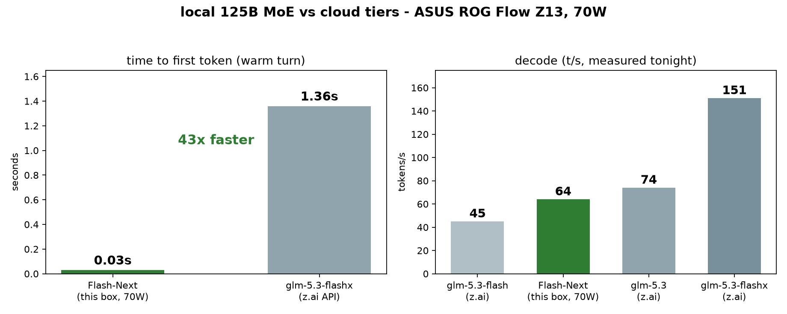
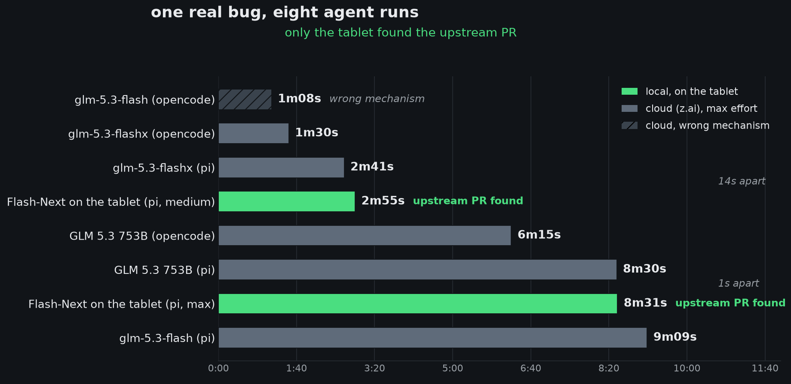
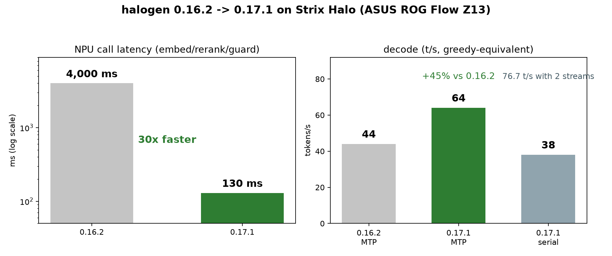

# Local AI Coding Agent for AMD Strix Halo (Ryzen AI Max+ 395)

**Qwen3.8 125B on the Radeon 8060S iGPU, four small models on the NPU, cloud optional** — a
self-hosted [pi](https://github.com/earendil-works/pi) coding-agent harness built on llama.cpp.

<div align="center">

[](https://github.com/aic0d3r/qwen38-strix-halo-harness/releases/latest)
[](#install)
[](docs/ENGINES.md#cloud-models-are-a-supported-hybrid)
[](LICENSE)

[What you get](#what-you-get) •
[The stack](#the-stack) •
[Evidence](#evidence) •
[Install](#install) •
[Model files](#model-files) •
[Quick Start](#quick-start) •
[The NPU](#the-npu) •
[Crash recovery](#crash-recovery) •
[Upgrading halogen](#upgrading-halogen) •
[Documentation](#documentation) •
[License](#license)

</div>

A coding-agent harness for the **AMD Strix Halo** (Ryzen AI Max+ 395 / gfx1151): the
[pi coding agent](https://github.com/earendil-works/pi) driving **Qwen3.8 Flash-Next (125B)** on
the iGPU, with the NPU running the small side jobs (prompt-injection screening, fast routing
decisions, embedding dedup) and a llama.cpp sidecar writing commits and compaction summaries.
One-command setup, crash recovery that survives a killed server, and the **262k ctx** window the
engine is capable of.

It runs with **no API key and no outbound calls** by default, and switching to a cloud model mid
session is a supported shape rather than a fallback: the NPU tools and the whole sidecar suite
stay on-device either way, so screening, search and compaction never follow your code off the box
— [the hybrid, measured](docs/ENGINES.md#cloud-models-are-a-supported-hybrid).

**The model was never the hard part.** This repo is everything *around* the model: the launch
scripts, the extension suite, the allocator pre-flight, the speed tooling, and the measured
numbers behind every claim. Every benchmark here is logged — see
**[BENCHMARKS.md](docs/BENCHMARKS.md)** and the
**[local vs cloud head-to-head](docs/local-vs-cloud-model-comparison.md)**, seven runs of one real
debugging task rated against verified ground truth.

> [!TIP]
> **Just want the agent running?** `./setup.sh --halogen auto`, then `./start.sh ~/my-project`.
> The two things you must supply are [docker](#install) and the
> [model files](#model-files) (~124 GB, local). Everything else is optional, and
> `./setup.sh --doctor` tells you what is live.



Measured on an ASUS ROG Flow Z13 (Ryzen AI Max+ 395, Radeon 8060S, 128 GB) at 70 W sustained.

## What you get

- **One-command setup** — `./setup.sh` is idempotent: extensions, providers, sidecar download,
  keep-alive units, halogen launch, memory check. It touches nothing you configured yourself and
  probes every piece instead of trusting it — the NPU guard answers a real `/v1/moderations`
  probe, the vision tower shows `enabled: true` on `/health`, and the smoke test checks its own
  file artifact rather than the model's report.
- **Crash recovery** — `progress-tracker` checkpoints task and partial state; relaunch and say
  "continue". Verified across six scenarios, including `kill -9` at response 1, server death
  mid-task, and 15-deep compaction chains.
- **NPU side jobs** — the `npu-retrieval` extension ships `triage` (a constrained routing
  decision with per-option probabilities in ~120 ms) and `dedup_scan` (near-duplicate files by
  embedding similarity); `auto-guard` screens every prompt on the guard model as a fail-open
  tripwire (42 % recall / 0 % false positives on the 30-prompt canary — not a security boundary).
  See [The NPU](#the-npu).
- **Semantic code search** — the pinned [semble](https://pypi.org/project/semble/) MCP server
  (`search` + `find_related`), wired into `mcp.json` by setup. A/B on 18 ground-truth queries
  against the NPU RAG pipeline it replaced: 17/18 vs 13/18 top-3 hits, 2-3x faster queries, ~40x
  faster indexing. It needs no NPU and indexes any local path or remote git URL, on first query.
- **Sidecar suite off the main context** — `ling-tiny-compaction` (non-blocking, thinking off,
  10/10 rule retention on the canary), `ling-tiny-commit`, `ling-tiny-branch-summary`,
  `ling-tiny-repomap`. Diffs and transcripts never touch halogen's prompt cache, so a side call
  can never evict your session prefix.
- **Speed tooling** — `scripts/halogen-top.sh` (live prefill/decode dashboard) and
  `scripts/session-audit.sh --perf` (per-session throughput from the server logs).
- **`bench/` and `config/`** — `harness-ab.sh` (baseline vs kill+resume A/B, one command),
  `report-accuracy.py` (grades every file:line claim in a report against the tree), the
  `guard-canary.py` / `compaction-retention.py` canaries, `check-sidecar.sh` + `check-fixes.sh`
  (offline regression checks), plus `models.json.example` and the compaction snippet. Two
  numbers there must be understood, not copied: `reserveTokens` is per-model, and on halogen
  `maxTokens` must stay <= 8192 or the server 400s past ~32.7k ctx.
- **Also shipped** — `harness-tune` (`/tune` live knobs), `turn-timer`, `subagent/`
  (worker/scout/reviewer/planner, session-model inheritance), `/gauntlet` and `/speedtest`
  prompt templates, and opt-in voice (`./setup.sh --voice`: [privateer-speak](https://npm.im/privateer-speak)
  on a local Lemonade server — whisper STT 0.43 s, kokoro TTS 0.3 s, both on CPU). Measured
  no-ops were deleted; receipts in [`extensions/README.md`](extensions/README.md).

## The stack

One box, four model servers (five with voice), three pieces of silicon:

- **halogen** (`:8731`, iGPU) — Qwen3.8 Flash-Next 125B from a local checkpoint: the agent's main
  model, 262,144 ctx x 4 slots, prompt cache on.
- **NPU sidecars** (`:8731`, NPU) — four 0.6-0.8B models on the same server: guard, decider,
  embedder (and one idle reranker). Detailed in [The NPU](#the-npu).
- **ling3.0-tiny** (`:8090`, iGPU, llama.cpp) — the sidecar for commit messages, compaction
  summaries and repo maps.
- **semble** (child process, CPU) — semantic code search over `uvx`; no model server.
- **Lemonade** (`:13305`, CPU, opt-in `--voice`) — whisper STT and kokoro TTS.

Flow: every prompt is screened by the NPU guard before the main model sees it; the main model
generates on the iGPU with its prompt cache warm; side jobs that need a judgement in
milliseconds (is this injection, which of these three is it, which files are near-duplicates) go
to the NPU instead of the 125B model; sidecars read diffs and transcripts directly so they never
evict the cached prefix; and search runs on CPU against an index built at first query. Halogen is
the only engine this harness provisions — [what breaks on another engine](docs/ENGINES.md) is
measured, too.

## Evidence

<table>
  <tr>
    <td align="center"><strong>Local vs cloud: TTFT and decode by tier</strong><br></td>
    <td align="center"><strong>Wall-clock per run, seven runs</strong><br></td>
  </tr>
  <tr>
    <td align="center"><strong>halogen 0.16.2 to 0.17.1: NPU latency 4000ms to 130ms, decode 44 to 64 tok/s</strong><br></td>
    <td align="center"><strong>Every number in this README</strong><br>logged in <a href="docs/BENCHMARKS.md">docs/BENCHMARKS.md</a></td>
  </tr>
</table>

## Install

```sh
# one-time install: extensions, providers, sidecar, pi defaults
./setup.sh

# launch halogen from your local checkpoint (zero downloads)
./setup.sh --halogen auto

# status check any time, ends with a live model ping
./setup.sh --doctor
```

`--halogen auto` finds `*.hgn` in `.`, `/models`, `~/models`, `~/Downloads`, or take a path
explicitly; restart later with `./start-halogen.sh` (written on first launch); `--no-halogen`
installs pi without container management (laptop pi against your own providers, or against a
remote Strix Halo appliance via `baseUrl` + `PI_NPU_BASE`). Other flags: `--voice`,
`--halogen-upgrade [tag]`, `--uninstall`. Prerequisites: docker (setup will not sudo-install it),
pi (setup installs it via npm if missing), `uvx` from [uv](https://docs.astral.sh/uv) for semantic
search, and an IOMMU-enabled gfx1151 box for the NPU driver. The launch is pinned to local files
(no `HALOGEN_DOWNLOAD`), so the engine makes no outbound connections.

> [!NOTE]
> **Do not clone the whole model repo** — it carries ~190 GB of optional variants and the minimum
> set is ~124 GB. `./setup.sh --halogen auto` offers to fetch exactly the right files and resumes
> where it stopped if interrupted.

Plain `pi` also works after setup: startup defaults point at halogen, and existing overrides are
never touched.

## Model files

From [huggingface.co/peonist-ai/halogen-qwen3.8-flash-next](https://huggingface.co/peonist-ai/halogen-qwen3.8-flash-next),
plus four separate NPU repos:

| file | size | why |
|---|---|---|
| `qwen38-flash-next-v2.hgn` | 66.7 GB | the main checkpoint (MTP drafter head included) |
| `qwen38-flash-next-ngram.hgn` | 51.2 GB | **required** — the checkpoint's weight lookup table (read through the page cache; not an n-gram drafter despite the name) |
| `qwen38-flash-next-vision.hgn` | 0.9 GB | vision tower — image input is enabled by default |
| `tokenizer/` | small | chat template the engine loads |
| `npu/decider-0.8b/` | 2.3 GB | `triage` — constrained decisions (~120 ms) |
| `npu/qwen3-embedding-0.6b/` | 848 MB | `dedup_scan` embeddings |
| `npu/qwen3guard-gen-0.6b/` | 787 MB | injection screening (`auto-guard`) |
| `npu/qwen3-reranker-0.6b/` | 821 MB | **unused since v1.1** — loaded only because it is in the default `HALOGEN_NPU_MODELS`; drop it (see [The NPU](#the-npu)) |

One directory (e.g. `~/models/halogen-qwen3.8-flash-next/`), NPU models in a lowercase `npu/`
subdirectory; the launcher mounts it read-only at `/models` inside the container, so the engine
reads its NPU models from `/models/npu/`.

```sh
pip install -U "huggingface_hub[cli]"   # provides the hf command
hf download peonist-ai/halogen-qwen3.8-flash-next \
  qwen38-flash-next-v2.hgn qwen38-flash-next-ngram.hgn qwen38-flash-next-vision.hgn tokenizer/ \
  --local-dir ~/models/halogen-qwen3.8-flash-next
for n in decider-0.8b qwen3-embedding-0.6b qwen3guard-gen-0.6b qwen3-reranker-0.6b; do
  hf download peonist-ai/halogen-npu-$n --local-dir ~/models/halogen-qwen3.8-flash-next/npu/$n
done
```

Skip the rest (`w4b.hgn`, `ht43.hgn`, `MTP.hgn`, `w4b.overlay*.hgn`, `qwen3.5-2b`) — the
checkpoint carries its own draft head. Upstream also ships an optional smaller/faster `ht43.hgn`
checkpoint; the default stays `v2` — pass its path explicitly to use it. First cold boot pins the
47.7 GiB lookup table from disk, so a few minutes of startup is normal.
## Quick Start

```sh
# daily driver: heals any dead server, then opens the pi TUI
./start.sh ~/my-project
```

In the session: `read`/`edit`/`bash` as usual, `mcp__semble__search` for "where is X implemented",
`commit` for a sidecar-written message, `triage` when a decision is a one-word call, and `/tune`
to change compaction headroom, output budget, temperature or ubatch mid-session. Codebase search
needs no setup — semble indexes on first query.

The default launch is halogen's native max (**262,144 ctx x 4 slots**) behind an allocator
pre-flight gate; if order-9 pages are low it recovers or fails in seconds with the exact fix
command. Context knobs, the `vm-compact.timer` and the small-context opt-out are in
[Operations](docs/OPS.md).

## The NPU

The NPU is not where the big model runs. It runs four small models whose whole job is to answer,
in 0.1-1 s, questions the 125B model would take 5-90 s on — and without touching the main model's
prompt cache. halogen exposes them on the same `:8731` server.

| model | how it is called | used by | what it does | measured |
|---|---|---|---|---|
| `decider-0.8b` | `/v1/chat/completions` with a `json_schema` enum + logprobs | `triage` | picks one of 2-5 options, returns per-option probabilities | ~120 ms, 78 % on 18 binary prompts |
| `qwen3-embedding-0.6b` | `/v1/embeddings` | `dedup_scan` | embeds files for near-duplicate detection | 70 ms/query, 38 files in 8.4 s |
| `qwen3guard-gen-0.6b` | `/v1/moderations` | `auto-guard`, every prompt | flags prompt injection | 70-130 ms, 42 % recall / 0 % fp |
| `qwen3-reranker-0.6b` | `/v1/rerank` | **nothing since v1.1** | ranked the retired NPU search | 130 ms, idle |

> [!NOTE]
> The NPU does **not** do codebase search. It used to — an embedding + rerank RAG pipeline — and
> that moved to the semble MCP server in v1.1 (17/18 vs 13/18 top-3, 2-3x faster queries). What
> the NPU still owns is everything the big model is too slow or too expensive for: per-prompt
> screening, one-shot routing decisions, and embedding sweeps over thousands of files.

Everything on it is optional and every extension degrades quietly: with no halogen server,
`auto-guard` fails open, `triage` and `dedup_scan` return an error string, and the agent keeps
working — search, commit messages and compaction never needed the NPU.

```sh
# which NPU models the server has configured vs actually loaded (they load on first use)
curl -s localhost:8731/health | python3 -c "import json,sys;print(json.load(sys.stdin)['npu'])"

# trim the loaded set — the reranker is dead weight unless you re-add reranking yourself
HALOGEN_NPU_MODELS=decider-0.8b,qwen3-embedding-0.6b,qwen3guard-gen-0.6b ./start-halogen.sh
```

> [!WARNING]
> **GPU + NPU at the same time is only safe with the GPU fabric clock held** (halogen NPU docs) —
> without it, concurrent GPU and NPU work can hang the device or corrupt output.
> `./setup.sh --doctor` probes it and prints the one-time host-side install for the
> `halogen-fabric-clock` unit when it is not held. The container holds the clock while it runs;
> the gap is any NPU call made with no container up.

## Crash recovery

**pi dies, you kill it, the server dies mid-task** — doesn't matter. Relaunch `./start.sh` in the
same directory and say "continue": `progress-tracker` wrote a checkpoint (task + partial state)
and the fresh session picks it up. **Verified across six scenarios**, including `kill -9` at
response 1, server death mid-task, and 15-deep compaction chains (reliable to ~8-10 compactions;
deeper chains deserve a re-orientation pass).

Known limits, measured and documented: one pi task per repo (concurrent sessions race on the
checkpoint — set `PI_PROGRESS_FILE` per task for parallel work), and a stale checkpoint from a
previous task is data, not instructions: `rm PROGRESS.md` when switching tasks.

## Upgrading halogen

The image tag is **pinned** in `server/start-halogen.sh` (`HALOGEN_IMAGE_TAG`, default the version
this harness was last validated on). One command does it safely:

```sh
./setup.sh --halogen-upgrade          # default: latest
./setup.sh --halogen-upgrade 0.18.0   # or a specific tag
```

It pulls the image, refreshes the NPU model files (new images can need new NPU device files — 0.18
added the embedding `u10.elf`), restarts, then runs the acceptance battery: health + version
match, prompt cache on, NPU probes < 1 s, guard smoke, MTP decode > 30 t/s, and a `pi -p` smoke.
Only then does the pin move; any failed check restores the previous NPU files and restarts on the
previous pin automatically. Read the changelog first — tool-calling, schema, cache and
log-routing behavior have all changed between releases.

## Uninstall

```sh
./setup.sh --uninstall
```

Removes everything the installer provisioned — extensions, templates, skills, theme, pi defaults,
the two providers (only where they still match what setup set) and the systemd units — after
backing all of it up to `~/pi-harness-uninstall-backup-*.tar.gz`. **Deliberately left alone:**
your own model entries, `mcp.json`, the sidecar GGUF (the reclaim command is printed), the halogen
container and your checkpoint files.

## Documentation

- **[BENCHMARKS.md](docs/BENCHMARKS.md)** — measured numbers: decode/prefill, NPU latencies, canary
  results, and every claim in this README with its logged run.
- **[Local vs cloud model comparison](docs/local-vs-cloud-model-comparison.md)** — seven runs, one
  real debugging task, answers rated against verified ground truth.
- **[Engines](docs/ENGINES.md)** — the two stacks, what breaks on a non-halogen engine, sidecar
  isolation, and running a cloud model with the local NPU tools.
- **[llama.cpp path](docs/LLAMACPP.md)** — the full-control engine: engine build, GGUFs and
  drafters, GPU-memory boot args, pi wiring.
- **[Operations](docs/OPS.md)** — context size and fragmentation, watching prefill/decode,
  troubleshooting table.
- **[extensions/README.md](extensions/README.md)** — per-extension notes and the measured value
  table.
- **[CHANGELOG.md](CHANGELOG.md)** — release history, including what was removed after testing.

## Posts

- [Qwen3.8-27B on Strix Halo at 31 t/s decode, the full stack guide](https://www.reddit.com/r/LocalLLaMA/comments/1vsw6nz/) (r/LocalLLaMA)
- [Running a local coding agent on Strix Halo with pi + llama.cpp](https://www.reddit.com/r/StrixHalo/comments/1w6c5nz/) (r/StrixHalo)
- [Qwen3.8-Flash-Next on Strix Halo: 40 t/s sustained decode](https://www.reddit.com/r/StrixHalo/comments/1w6cf5t/) (r/StrixHalo)
- [Neon Ladder: a playtest-graded benchmark for local LLM stacks](https://www.reddit.com/r/LocalLLaMA/comments/1w6cjm5/) (r/LocalLLaMA)

Companion repo: **[neon-ladder](https://github.com/aic0d3r/neon-ladder)** — the playtest-graded
benchmark this stack was validated on. Benchmark protocol questions live there; harness questions
live here.

## License

[MIT](LICENSE)
