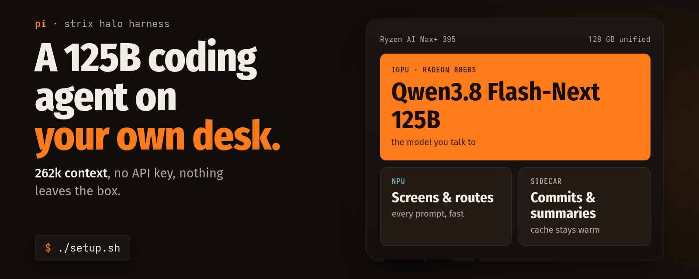

# AI Coding Agent Harness for Any Hardware (Tuned for Strix Halo)

**Run a coding agent on whatever you have, tuned for AMD Strix Halo.** Works with any OpenAI-compatible engine or cloud
model. On a Ryzen AI Max+ 395 (Strix Halo) it runs a 125B Qwen3.8 Flash-Next on the iGPU
with **262k context**, NPU models screening and routing prompts, and a sidecar writing commits and
summaries. Guided setup for llama.cpp, vLLM, Ollama, LM Studio and more. Built on
[pi](https://github.com/earendil-works/pi).

> **Not only for Strix Halo, and not only local.** The harness (token-saving extensions, context
> management, guards, sidecar) runs on any machine, with any OpenAI-compatible engine or a cloud
> model. Only the NPU tools need Strix Halo, and they're optional. Strix Halo is just the
> reference setup.

<div align="center">

[](https://github.com/aic0d3r/qwen38-strix-halo-harness/releases/latest)
[](#install)
[](docs/ENGINES.md#cloud-models-are-a-supported-hybrid)
[](LICENSE)

**Get started:**
[Guided setup](#guided-setup) •
[Install](#install) •
[Model files](#model-files) •
[Quick start](#quick-start)<br>
**Why it works:**
[Efficiency](#efficiency) •
[What you get](#what-you-get) •
[The stack](#the-stack) •
[Evidence](#evidence)<br>
**Running it:**
[The NPU](#the-npu) •
[Crash recovery](#crash-recovery) •
[Upgrading halogen](#upgrading-halogen)<br>
**More:**
[Documentation](#documentation) •
[License](#license)

</div>



- **Guided setup:** `./setup.sh` detects your engine (halogen, llama.cpp, Strata, vLLM, Ollama,
  LM Studio) and wires pi to it. The NPU tools are Strix Halo only.
- **Private by default:** no API key, no outbound calls. Cloud models are a supported
  [hybrid](docs/ENGINES.md#cloud-models-are-a-supported-hybrid); screening, search and compaction
  stay on-device either way.
- **Lean by design:** every layer keeps tokens and calls off the main model. [rtk](https://npm.im/@estebanforge/pi-rtk-optimizer)
  compresses command output before it reaches context, `tool-trim` caps long output and turns
  repeat file reads into a pointer, semantic search replaces read-everything exploration, and
  side jobs run on the NPU or a small sidecar so the prompt cache is never evicted. Fewer tokens
  means faster turns locally and a smaller bill on a cloud model. See
  [Efficiency](#efficiency) for what is measured.
- **Crash-proof:** kill the server or pi mid-task, relaunch, say "continue".
- **Measured:** the model was never the hard part. Everything around it is here, and every claim is
  logged in [BENCHMARKS.md](docs/BENCHMARKS.md) and the
  [local vs cloud head-to-head](docs/local-vs-cloud-model-comparison.md).

> [!TIP]
> **Start here:** run `./setup.sh` in a terminal. It is the guided setup for any engine — see
> [Guided setup](#guided-setup). On a Strix Halo with the halogen checkpoint, `./setup.sh --halogen auto`
> then `./start.sh ~/my-project` is the zero-question path (needs [docker](#install) and the
> [model files](#model-files), ~124 GB). `./setup.sh --doctor` tells you what is live.


Measured on an ASUS ROG Flow Z13 (Ryzen AI Max+ 395, Radeon 8060S, 128 GB) at 70 W sustained.

## Guided setup

`./setup.sh` in a terminal (same as `./harness setup`) runs a wizard that works for any engine:

0. **Checks for harness updates** first: if your checkout is behind origin it lists the new commits
   and offers `git pull --ff-only`, then restarts on the new code. It stays quiet offline, with local
   edits, or when there is nothing new.
1. **Detects** your hardware and which engines are already serving: halogen, llama.cpp, Strata,
   vLLM, Ollama, LM Studio.
2. **Shows one engine menu every run** (current engine first): running or not, the served model,
   the last measured prefill/decode speed, what you lose on that engine (the NPU tools off halogen),
   and a warning when halogen and gufo would fight over the same GPU memory. Picking an engine that
   is down offers to start it (halogen, gufo), asks before stopping the one holding the memory, and
   waits until it answers. With no engine running at all (a fresh box) the menu still shows, halogen
   first on an NPU box, and picking halogen without a checkpoint offers the ~124 GB download
   ([`scripts/download-halogen.sh`](scripts/download-halogen.sh)). Other engines print how to start
   them. To switch later, run `./setup.sh` again.

   **All questions come first**, then a summary ("about to: ...") and one `Continue? [Y/n]`; after
   that the run needs nothing from you. Prompts use `gum` when it is installed. **Esc** (or Ctrl-C) at
   any prompt exits cleanly; before `Continue?` nothing has been installed or started.
   The first run prints the full install output; later runs print one line per install step with
   only warnings and failures in full (everything goes to `~/.pi/agent/setup.log`; `--verbose`
   shows it all). One-time sudo fixes (fabric clock, vm-compact) are shown once, then only by
   `--doctor` until fixed.
3. **Writes the pi provider** with per-model defaults (reasoning, sampling, compaction reserve)
   from [`config/profiles.json`](config/profiles.json), and records the active engine in a
   profile that the sidecar, guard and NPU extensions read, so they follow your engine instead
   of assuming halogen.
4. **Probes** prefill and decode for ~1 min and sizes `maxTokens` and the compaction reserve to
   what it measured, then prints a short summary and offers to start pi in the current directory. The probe is one short
   prompt (a few thousand tokens), so its speeds are for sizing limits only: they are not comparable to
   the engine benchmark tables below, which use the `halogen-cmp.py` battery and 2k-119k depth prompts.
5. **Extras, asked once and remembered** (`./harness config` changes one; `./harness setup --reconfigure` asks all again): whether to
   run the **ling-tiny sidecar** (default yes; it holds ~8 GiB of GPU memory, and "no" means the
   main model writes commits and summaries, with compaction blocking on it; non-interactive:
   `./setup.sh --no-sidecar` / `--sidecar`), the engine
   update check (any engine with a known release source: halogen, gufo, Strata, llama.cpp, vLLM,
   Ollama; on halogen, gufo and Strata it offers the safe upgrade right away
   (`scripts/upgrade-<engine>.sh`: update, restart, check, roll back on failure), on the others it prints the upgrade command; `start.sh` repeats the one-line notice, `./harness update-check` on demand), and voice. Serena
   language servers for the languages found in your project are enabled automatically in
   `.serena/project.yml` (restart serena to load them).

Servers you started yourself are never restarted. Run non-interactively (scripts, CI) and
`./setup.sh` does the plain install instead.

| command | does |
|---|---|
| `./harness setup` | the wizard above |
| `./harness detect` | list hardware and running engines, change nothing |
| `./harness use <engine>[/<model>]` | switch pi to another engine or model |
| `./harness status` | engine up/down, model, NPU, saved tuning, sidecar state |
| `./harness config` | menu of saved answers (engine, sidecar, voice, update check, sudo hints); change one, applied right away |
| `./harness tune` | re-run the speed probe and re-size the limits |
| `./setup.sh --doctor` | read-only health check of the whole install |
| `./setup.sh --refresh-mcp` | reset the serena/semble MCP exposure and ensure the default DDG server (backs up `mcp.json` first) |

## Efficiency

The harness is tuned to spend as few tokens, and as little main-model time, as possible:

| lever | what it does | measured |
|---|---|---|
| **rtk** (`pi-rtk-optimizer`) | rewrites bash commands through the `rtk` binary so test, build and git output arrives compressed | per-command savings in `rtk gain`; no aggregate benchmark in this repo yet |
| **`tool-trim`** | strips ANSI/progress noise, caps huge output (full text saved to a file), identical re-reads of unchanged files become a pointer; a whole-file read of a big source file gets a one-line hint to use serena or `offset`/`limit` | token savings shown by `/usage` |
| **`image-prune`** | a screenshot the agent read stays in every later request until a provider refuses it (30 on DeepInfra) and it keeps costing prefill; only the newest 4 images go out, older or duplicate ones become a re-read hint. Session files keep every image. `setup.sh` also caps image resolution on every image-capable model at 450×1000 (`scripts/set-image-limits.py`, `PI_IMAGE_MAX=WxH` or `off`): a 1080×2400 phone screenshot drops from ~1,500 to ~600 Claude tokens | logged to `harness-events.jsonl` (`c: "image-prune"`) |
| **serena** (LSP symbol tools) | reads one function or an outline instead of the whole file; precise symbol edits and renames | 822 chars for a function body vs 13,980 to read the file; 390 for an outline; callers cost more than grep ([details](docs/BENCHMARKS.md#serena-context-returned-per-navigation-task-2026-10-16)) |
| **semble search** | finds code by meaning instead of reading files to explore | 17/18 vs 13/18 top-3 hits, 2-3x faster queries, ~40x faster indexing than the NPU pipeline it replaced |
| **Sidecar + NPU** | commits, compaction and repo maps run off the main model; screening and routing on the NPU | compaction ~24 s non-blocking vs ~52 s blocking; large commit diffs 18.5k to 7.1k tokens (2.5x faster) |
| **Warm prompt cache** | diffs and transcripts never touch the main model's prefix | warm replay 0.01-0.05 s on halogen |

For device or browser testing, prefer text over pixels: `adb shell uiautomator dump` or an
accessibility snapshot costs a few hundred tokens; when a screenshot is needed, crop to the area
that matters (`adb exec-out screencap -p | magick - -crop 1080x800+0+400 /tmp/s.png`).

On a cloud model the same levers cut input tokens directly, which is where the API savings come
from; locally they cut prefill time.

## What you get

- **One-command setup** — `./setup.sh` is idempotent: guided engine wiring, extensions, providers, sidecar download,
  keep-alive units, halogen launch (when chosen), memory check. It touches nothing you configured yourself and
  probes every piece instead of trusting it — the NPU guard answers a real `/v1/moderations`
  probe, the vision tower shows `enabled: true` on `/health`, and the smoke test checks its own
  file artifact rather than the model's report.
- **Crash recovery** — `progress-tracker` checkpoints task and partial state; relaunch and say
  "continue". Verified across six scenarios, including `kill -9` at response 1, server death
  mid-task, and 15-deep compaction chains.
- **NPU side jobs** — the `npu-retrieval` extension ships `triage` (a constrained routing
  decision with per-option probabilities in ~120 ms) and `dedup_scan` (near-duplicate files by
  embedding similarity); `auto-guard` screens every prompt on the guard model as a fail-open
  tripwire (42 % recall / 0 % false positives on the 30-prompt canary — not a security boundary).
  See [The NPU](#the-npu).
- **Symbol-precise code tools** — the [serena](https://github.com/oraios/serena) MCP server (find a
  symbol, its callers, an outline, diagnostics, symbol-level edits and renames), wired into
  `mcp.json` by setup and started on your current project. Install serena yourself (setup expects
  `~/.local/bin/serena`); it also needs a language server for your language. Measured: a function body in ~820 chars instead of reading a ~14,000-char file. In real
  sessions the agent reached for `read` far more often, so `tool-trim` now hints at serena or
  `offset`/`limit` after a big whole-file source read, and the installed `AGENTS.md` says the same.
  Nine core tools are `direct`; the long tail stays script-reachable through `codemode` when it is
  active (`./setup.sh --refresh-mcp` restores the shipped exposure).
- **Semantic code search** — the pinned [semble](https://pypi.org/project/semble/) MCP server
  (`search` + `find_related`), wired into `mcp.json` by setup. A/B on 18 ground-truth queries
  against the NPU RAG pipeline it replaced: 17/18 vs 13/18 top-3 hits, 2-3x faster queries, ~40x
  faster indexing. It needs no NPU and indexes any local path or remote git URL on first query.
- **Web search and page reading** — the [DuckDuckGo MCP server](https://github.com/nickclyde/duckduckgo-mcp-server)
  (`search`, `fetch_content`, `expand_link`), wired into `mcp.json` and enabled by default. No
  account or API key; `fetch_content` returns Markdown, with `max_length`/`start_index` for long
  pages. Jina remains optional (disabled by default) for academic/image/rerank work.
- **Sidecar suite off the main context** — `ling-tiny-compaction` (non-blocking, thinking off,
  10/10 rule retention on the canary), `ling-tiny-commit`, `ling-tiny-branch-summary`,
  `ling-tiny-repomap`. Diffs and transcripts never touch halogen's prompt cache, so a side call
  can never evict your session prefix.
- **Speed tooling** — `scripts/halogen-top.sh` (live prefill/decode dashboard) and
  `scripts/session-audit.sh --perf` (per-session throughput from the server logs).
- **`bench/` and `config/`** — `harness-ab.sh` (baseline vs kill+resume A/B, one command),
  `report-accuracy.py` (grades every file:line claim in a report against the tree), the
  `guard-canary.py` / `compaction-retention.py` canaries, `check-sidecar.sh` + `check-fixes.sh`
  (offline regression checks), plus `models.json.example` and the compaction snippet. Two
  numbers there must be understood, not copied: `reserveTokens` is per-model, and on halogen
  `maxTokens` must stay <= 8192 or the server 400s past ~32.7k ctx.
- **Also shipped** — `harness-tune` (`/tune` live knobs), `harness-update` (daily behind-origin notice + `/harness-update`; `HARNESS_AUTOUPDATE=1` applies it at startup), `turn-timer`, `subagent/`
  (worker/scout/reviewer/planner, session-model inheritance), `/gauntlet` and `/speedtest`
  prompt templates, and opt-in voice (`./setup.sh --voice`: [privateer-speak](https://npm.im/privateer-speak)
  on a local Lemonade server — whisper STT 0.43 s, kokoro TTS 0.3 s, both on CPU). Three pi packages
  are installed by `setup.sh` when missing — [ponytail](https://github.com/DietrichGebert/ponytail),
  [rpiv-ask-user-question](https://npm.im/@juicesharp/rpiv-ask-user-question) (the structured
  `ask_user_question` tool) and pi-rtk-optimizer — they live in `~/.pi/agent/settings.json`, not in this repo. Measured
  no-ops were deleted; receipts in [`extensions/README.md`](extensions/README.md).

## The stack

One box, two model servers (three with voice), three pieces of silicon:

- **halogen** (`:8731`, iGPU) — Qwen3.8 Flash-Next 125B from a local checkpoint: the agent's main
  model, 262,144 ctx x 4 slots, prompt cache on.
- **NPU sidecars** (`:8731`, NPU) — three 0.6-0.8B models on the same server: guard, decider,
  embedder (the reranker is no longer launched). Detailed in [The NPU](#the-npu).
- **ling3.0-tiny** (`:8090`, iGPU, llama.cpp) — the sidecar for commit messages, compaction
  summaries and repo maps.
- **semble** (child process, CPU) — semantic code search over `uvx`; no model server.
- **Lemonade** (`:13305`, CPU, opt-in `--voice`) — whisper STT and kokoro TTS.

Flow: every prompt is screened by the NPU guard before the main model sees it; the main model
generates on the iGPU with its prompt cache warm; side jobs that need a judgement in
milliseconds (is this an injection, which of these three is it, which files are near-duplicates) go
to the NPU instead of the 125B model; sidecars read diffs and transcripts directly so they never
evict the cached prefix; and search runs on CPU against an index built at first query. Halogen is
the only engine `setup.sh` launches and manages; every other engine is detected and wired but you
run it yourself ([what breaks on another engine](docs/ENGINES.md) is measured, too).

### Halogen vs gufo (the best engines for Strix Halo)

**The engine is swappable.** The harness is a pi setup plus extensions that talk to an
OpenAI-compatible endpoint, so on other hardware (NVIDIA, Apple Silicon, plain CPU) use any
server that fits it: [Strata](docs/ENGINES.md#strata-the-pick-for-nvidia-and-amd-desktop-gpus) (NVIDIA/AMD desktop GPUs), llama.cpp (CUDA/Metal builds), vLLM, Ollama, LM Studio, MLX, or gufo where
it supports your GPU. Start it, run `./setup.sh` (or `./harness use <engine>`) and skip
`--halogen`; hand-writing `models.json` ([example](config/models.json.example)) still works. Only the Strix Halo numbers below are measured here; nothing on NVIDIA or Apple was
tested. What you lose off halogen is the NPU tooling ([list](docs/ENGINES.md#what-breaks-on-another-engine)).
Which engine for which hardware:

| your hardware | engine | why |
|---|---|---|
| **Strix Halo** (Ryzen AI Max, 128 GB unified) | **halogen** | fastest measured, plus the NPU tools (guard, triage, dedup) |
| Strix Halo, want open source | gufo, or Strata | both open, both lose the NPU tools; Strata decodes faster, gufo prefills faster (table below) |
| **NVIDIA RTX 20-50 / AMD RX 7000-9000, 12 GB+ VRAM** | **[Strata](docs/ENGINES.md#strata-the-pick-for-nvidia-and-amd-desktop-gpus)** | built for it; not measured here, see Strata's own benchmarks |
| Apple Silicon, anything else | llama.cpp / MLX / Ollama / LM Studio | not measured here |

On Strix Halo, matched measurements on this box (halogen and gufo A/B in one session, fabric clock
held; Strata re-run 2026-10-14 with the same `halogen-cmp.py` battery and depth prompts, greedy,
thinking off, nonce-tagged so nothing is cached; UD-IQ4_XS, 256k ctx):

| | halogen 0.18.5 (default) | Strata 0.1.44.1 (tuned) | gufo 0.12.0 |
|---|---|---|---|
| decode, 10-prompt battery (median) | **65 t/s** | 43 t/s | 40 t/s |
| decode, 2k to 119k context | **47-50 t/s** | 32-36 t/s | 29-32 t/s |
| cold prefill | **~1,520 t/s** (131k in 86 s; 119k in 78 s) | ~990 t/s (119k in 120 s) | ~1,270 t/s (119k in 94 s) |
| warm cache replay | 0.01-0.05 s | 0.4-0.9 s (earlier session) | ~0.1 s |
| NPU tools (guard, triage, dedup) | yes | no | no |
| license | closed | open | **MIT** |

Halogen stays the default on Strix Halo (fastest, NPU tools). Strata and gufo are the open
alternatives; on this chip Strata is not the upgrade (its pitch is NVIDIA/AMD desktop GPUs). To run
gufo, stop halogen first (they share one memory heap), then `server/start-gufo-flashnext.sh`
(UD-Q4_K_XL + MTP, `:8080`) and `./setup.sh --gufo` to wire pi to it. Full numbers: [ENGINES.md](docs/ENGINES.md#what-breaks-on-another-engine).

## Evidence

<table>
  <tr>
    <td align="center"><strong>Local vs cloud: TTFT and decode by tier</strong><br></td>
    <td align="center"><strong>Wall-clock per run, seven runs</strong><br></td>
  </tr>
  <tr>
    <td align="center"><strong>halogen 0.16.2 to 0.17.1: NPU latency 4000ms to 130ms, decode 44 to 64 tok/s</strong><br></td>
    <td align="center"><strong>Every number in this README</strong><br>logged in <a href="docs/BENCHMARKS.md">docs/BENCHMARKS.md</a></td>
  </tr>
</table>

## Install

```sh
# any engine: guided wizard in a terminal, plain install in scripts/CI (see Guided setup)
./setup.sh

# Strix Halo: launch halogen from your local checkpoint (zero downloads)
./setup.sh --halogen auto

# status check any time, ends with a live model ping
./setup.sh --doctor
```

`--halogen auto` finds `*.hgn` in `.`, `/models`, `~/models`, `~/Downloads` (or pass a path
explicitly); restart later with `./start-halogen.sh` (written on first launch); `--no-halogen`
installs pi without container management (laptop pi against your own providers, or against a
remote Strix Halo appliance via `baseUrl` + `PI_NPU_BASE`). `--strata [url]` and `--gufo [url]`
do a pi-only install with a provider for that engine. Other flags: `--voice`,
`--halogen-upgrade [tag]`, `--uninstall`, `--help`. Prerequisites: docker (setup will not sudo-install it),
pi (setup installs it via npm if missing), `uvx` from [uv](https://docs.astral.sh/uv) for semantic
and web search, and an IOMMU-enabled gfx1151 box for the NPU driver. The launch is pinned to local files
(no `HALOGEN_DOWNLOAD`), so the engine makes no outbound connections.

> [!NOTE]
> **Do not clone the whole model repo** — it carries ~190 GB of optional variants and the minimum
> set is ~124 GB. `./setup.sh --halogen auto` offers to fetch exactly the right files and resumes
> where it stopped if interrupted.

Plain `pi` also works after setup: startup defaults point at the engine you chose, and existing
overrides are never touched.

## Model files

From [huggingface.co/peonist-ai/halogen-qwen3.8-flash-next](https://huggingface.co/peonist-ai/halogen-qwen3.8-flash-next),
plus four separate NPU repos:

| file | size | why |
|---|---|---|
| `qwen38-flash-next-v2.hgn` | 66.7 GB | the main checkpoint (MTP drafter head included) |
| `qwen38-flash-next-ngram.hgn` | 51.2 GB | **required** — the checkpoint's weight lookup table (read through the page cache; not an n-gram drafter despite the name) |
| `qwen38-flash-next-vision.hgn` | 0.9 GB | vision tower — image input is enabled by default |
| `tokenizer/` | small | chat template the engine loads |
| `npu/decider-0.8b/` | 2.3 GB | `triage` — constrained decisions (55 ms warm, ~1.6 s to wake) |
| `npu/qwen3-embedding-0.6b/` | 848 MB | `dedup_scan` embeddings |
| `npu/qwen3guard-gen-0.6b/` | 787 MB | injection screening (`auto-guard`) |
| `npu/qwen3-reranker-0.6b/` | 821 MB | **optional file now** — dropped from the default `HALOGEN_NPU_MODELS` (v1.4): nothing calls `/v1/rerank`; keep it only if you re-add reranking yourself |

One directory (e.g. `~/models/halogen-qwen3.8-flash-next/`), NPU models in a lowercase `npu/`
subdirectory; the launcher mounts it read-only at `/models` inside the container, so the engine
reads its NPU models from `/models/npu/`.

```sh
pip install -U "huggingface_hub[cli]"   # provides the hf command
hf download peonist-ai/halogen-qwen3.8-flash-next \
  qwen38-flash-next-v2.hgn qwen38-flash-next-ngram.hgn qwen38-flash-next-vision.hgn tokenizer/ \
  --local-dir ~/models/halogen-qwen3.8-flash-next
for n in decider-0.8b qwen3-embedding-0.6b qwen3guard-gen-0.6b qwen3-reranker-0.6b; do
  hf download peonist-ai/halogen-npu-$n --local-dir ~/models/halogen-qwen3.8-flash-next/npu/$n
done
```

Skip the rest (`w4b.hgn`, `ht43.hgn`, `MTP.hgn`, `w4b.overlay*.hgn`, `qwen3.5-2b`) — the
checkpoint carries its own draft head. Upstream also ships an optional smaller/faster `ht43.hgn`
checkpoint; the default stays `v2` — pass the `ht43.hgn` path explicitly to use it. First cold boot pins the
47.7 GiB lookup table from disk, so a few minutes of startup is normal.

## Quick start

```sh
# daily driver, any engine: heals what it manages, then opens the pi TUI on the engine ./setup.sh picked
./start.sh ~/my-project
```

`start.sh` (= `./harness up`, then pi) starts the engine you picked if it is down (halogen, gufo,
Strata; asks first if another one holds the GPU memory, and never launches halogen beside gufo or
Strata), re-checks the install quietly (only problems print; full log `~/.pi/agent/setup.log`),
shows the update notice with the upgrade offer, and opens pi on the provider and model from the
wizard. Engines it has no launcher for (vLLM, Ollama, ...) get a warning and pi opens anyway.
`./harness status` shows what pi is pointed at.

In the session: `read`/`edit`/`bash` as usual, `mcp__semble__search` for "where is X implemented",
`commit` for a sidecar-written message, `triage` when a decision is a one-word call, and `/tune`
to change compaction headroom, output budget, temperature or ubatch mid-session. Codebase search
needs no setup — semble indexes on first query.

The default launch is halogen's native max (**262,144 ctx x 4 slots**) behind an allocator
pre-flight gate; if order-9 pages are low it recovers or fails in seconds with the exact fix
command. Context knobs, the `vm-compact.timer` and the small-context opt-out are in
[Operations](docs/OPS.md).

### Live stats

```sh
# live dashboard in a second terminal: busy state, queue, KV pool, per-request prefill/decode t/s, cache
./scripts/halogen-top.sh          # optional refresh interval in seconds (default 1); piped = one log line per request
./scripts/halogen-top.sh --strata # same for a Strata server on :8080 (or --strata http://host:port)

# after a session: halogen version vs pin, sidecar rejections, cache-broken prefills, errors
./scripts/session-audit.sh        # newest session by default; add --perf for its prefill/decode throughput, --harness for sidecar/NPU work
```

Halogen only updates its counters when a request finishes, so the dashboard shows per-request
rates, not a mid-stream ticker. Leave `halogen-top.sh` running if you want `--perf` to diff
`/metrics` over a session — it records every scrape to `~/.local/state/halogen-top/history.csv`.
Point it at a remote box with `HALOGEN_URL=http://host:8731`. Details in
[Operations](docs/OPS.md).

## The NPU

The NPU is not where the big model runs. By default it runs three small models whose whole job is to answer,
in 0.1-1 s, questions the 125B model would take 5-90 s on — and without touching the main model's
prompt cache. Halogen exposes them on the same `:8731` server.

| model | how it is called | used by | what it does | measured |
|---|---|---|---|---|
| `decider-0.8b` | `/v1/chat/completions` with a `json_schema` enum + logprobs | `triage` | picks one of 2-5 options, returns per-option probabilities | **55 ms warm, ~1.6 s cold** (first call after idle, measured 10-14), 78 % on 18 binary prompts |
| `qwen3-embedding-0.6b` | `/v1/embeddings` | `dedup_scan` | embeds files for near-duplicate detection | 70 ms/query, 38 files in 8.4 s; low traffic (2 runs logged) and loads on first use, so it costs nothing resident |
| `qwen3guard-gen-0.6b` | `/v1/moderations` | `auto-guard`, every prompt | flags prompt injection | 207 ms p50 / 285 p95, **42 % recall, 0 % fp — re-verified 10-14** by `bench/guard-canary.py` |
| ~~`qwen3-reranker-0.6b`~~ | `/v1/rerank` | **nothing since v1.1** | ranked the retired NPU search | out of the default launch as of 10-14: 0 calls in the event log |

> [!NOTE]
> The NPU does **not** do codebase search. It used to — an embedding + rerank RAG pipeline — and
> that moved to the semble MCP server in v1.1 (17/18 vs 13/18 top-3, 2-3x faster queries). What
> the NPU still owns is everything the big model is too slow or too expensive for: per-prompt
> screening, one-shot routing decisions, and embedding sweeps over thousands of files.

Everything on it is optional and every extension degrades quietly: with no halogen server,
`auto-guard` fails open, `triage` and `dedup_scan` return an error string, and the agent keeps
working — search, commit messages and compaction never needed the NPU.

```sh
# which NPU models the server has configured vs actually loaded (they load on first use)
curl -s localhost:8731/health | python3 -c "import json,sys;print(json.load(sys.stdin)['npu'])"

# the default set is already trimmed (reranker out); override to go smaller still
HALOGEN_NPU_MODELS=decider-0.8b,qwen3guard-gen-0.6b ./start-halogen.sh
```

> [!WARNING]
> **GPU + NPU at the same time is only safe with the GPU fabric clock held** (halogen NPU docs) —
> without it, concurrent GPU and NPU work can hang the device or corrupt output.
> `./setup.sh --doctor` probes it and prints the one-time host-side install for the
> `halogen-fabric-clock` unit when it is not held. The container holds the clock while it runs;
> the gap is any NPU call made with no container up.

## Crash recovery

**pi dies, you kill it, the server dies mid-task** — doesn't matter. Relaunch `./start.sh` in the
same directory and say "continue": `progress-tracker` wrote a checkpoint (task + partial state)
and the fresh session picks it up. **Verified across six scenarios**, including `kill -9` at
response 1, server death mid-task, and 15-deep compaction chains (reliable to ~8-10 compactions;
deeper chains deserve a re-orientation pass).

Known limits, measured and documented: one pi task per repo (concurrent sessions race on the
checkpoint — set `PI_PROGRESS_FILE` per task for parallel work), and a stale checkpoint from a
previous task is data, not instructions: `rm PROGRESS.md` when switching tasks.

## Upgrading halogen

The image tag is **pinned** in `server/start-halogen.sh` (`HALOGEN_IMAGE_TAG`, default the version
this harness was last validated on). One command does it safely:

```sh
./setup.sh --halogen-upgrade          # default: latest
./setup.sh --halogen-upgrade 0.18.0   # or a specific tag
```

`setup.sh` asks once whether `start.sh` should print a one-line notice when a newer engine release exists
(`HALOGEN_CHECK_UPDATES=1|0` overrides; answer stored in `~/.pi/agent/harness-update-check`).
It only upgrades if you answer y.

It pulls the image, refreshes the NPU model files (new images can need new NPU device files — 0.18
added the embedding `u10.elf`), restarts, then runs the acceptance battery: health + version
match, prompt cache on, NPU probes < 1 s, guard smoke, MTP decode > 30 t/s, and a `pi -p` smoke.
Only then does the pin move; any failed check restores the previous NPU files and restarts on the
previous pin automatically. Read the changelog first — tool-calling, schema, cache and
log-routing behavior have all changed between releases.

## Uninstall

```sh
./setup.sh --uninstall
```

Removes everything the installer provisioned — extensions, templates, skills, theme, pi defaults,
the providers and the wizard's profile files (only where they still match what setup set) and the systemd units — after
backing all of it up to `~/pi-harness-uninstall-backup-*.tar.gz`. **Deliberately left alone:**
your own model entries, `mcp.json`, the sidecar GGUF (the reclaim command is printed), the halogen
container and your checkpoint files.

## Documentation

- **[BENCHMARKS.md](docs/BENCHMARKS.md)** — measured numbers: decode/prefill, NPU latencies, canary
  results, and every claim in this README with its logged run.
- **[Local vs cloud model comparison](docs/local-vs-cloud-model-comparison.md)** — seven runs, one
  real debugging task, answers rated against verified ground truth.
- **[Engines](docs/ENGINES.md)** — the engines and which fits which hardware, halogen vs gufo 0.12, what breaks on a non-halogen engine, sidecar
  isolation, and running a cloud model with the local NPU tools.
- **[llama.cpp path](docs/LLAMACPP.md)** — the full-control engine: engine build, GGUFs and
  drafters, GPU-memory boot args, pi wiring.
- **[Operations](docs/OPS.md)** — context size and fragmentation, watching prefill/decode,
  troubleshooting table.
- **[extensions/README.md](extensions/README.md)** — per-extension notes and the measured value
  table.
- **[CHANGELOG.md](CHANGELOG.md)** — release history, including what was removed after testing.

## Posts

- [Qwen3.8-27B on Strix Halo at 31 t/s decode, the full stack guide](https://www.reddit.com/r/LocalLLaMA/comments/1vsw6nz/) (r/LocalLLaMA)
- [Running a local coding agent on Strix Halo with pi + llama.cpp](https://www.reddit.com/r/StrixHalo/comments/1w6c5nz/) (r/StrixHalo)
- [Qwen3.8-Flash-Next on Strix Halo: 40 t/s sustained decode](https://www.reddit.com/r/StrixHalo/comments/1w6cf5t/) (r/StrixHalo)
- [Neon Ladder: a playtest-graded benchmark for local LLM stacks](https://www.reddit.com/r/LocalLLaMA/comments/1w6cjm5/) (r/LocalLLaMA)

Companion repo: **[neon-ladder](https://github.com/aic0d3r/neon-ladder)** — the playtest-graded
benchmark this stack was validated on. Benchmark protocol questions live there; harness questions
live here.

## License

[MIT](LICENSE)
