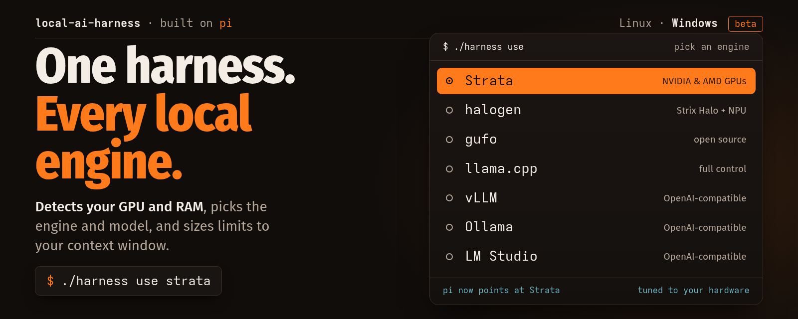
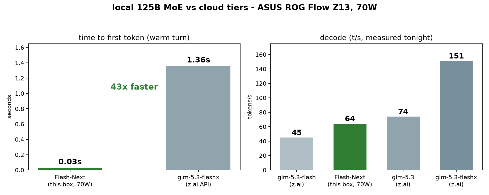

# Local AI Harness for Coding Agents

Run a coding agent on a local model, on any hardware. Built on [pi](https://github.com/earendil-works/pi). Linux, and
Windows (beta). Tuned and measured on AMD Strix Halo.

- **Detects your GPU and RAM**, recommends an engine and model, and sizes limits to your context window.
- **Switches engines:** Strata, llama.cpp, vLLM, Ollama, LM Studio, halogen, gufo, or a cloud model.
- **Cuts tokens:** compressed command output, symbol-level code tools, search by meaning.
- **Resumes after a crash:** relaunch, say "continue".

```sh
./setup.sh
```

<div align="center">

[](https://github.com/aic0d3r/local-ai-harness/releases/latest)
[](#install)
[](docs/ENGINES.md#cloud-models-are-a-supported-hybrid)
[](LICENSE)

[Install](#install) •
[Which engine](#which-engine) •
[Quick start](#quick-start) •
[Efficiency](#efficiency) •
[Docs](#documentation) •
[Posts](#posts)

</div>



## Install

You need pi (setup installs it with npm if missing) and `uvx` from [uv](https://docs.astral.sh/uv) for semantic and web
search.

```sh
# Linux, any engine: start your engine, then run the guided wizard
./setup.sh

# Strix Halo with the halogen checkpoint: needs docker and the ~124 GB model files
./setup.sh --halogen auto
./start.sh ~/my-project

# check the install any time; it ends with a live model ping
./setup.sh --doctor
```

The wizard asks every question first, shows a summary, and installs nothing until you confirm. Flags and the full
walkthrough: [docs/SETUP.md](docs/SETUP.md). Do not clone the whole model repo (~190 GB); `--halogen auto` fetches
exactly the files you need.

### Windows (beta)

`setup.ps1` is verified on a clean Windows 11 VM against a stub engine, not yet on Windows hardware with a real Strata.
Install [Strata](https://github.com/Niko1221/Strata) and start it, install pi (`irm https://pi.dev/install.ps1 | iex`),
then:

```powershell
powershell -ExecutionPolicy Bypass -File .\setup.ps1
```

It never installs or starts an engine, and the `./harness` wizard, launchers and sidecar are Linux only. Steps and
limits: [docs/WINDOWS.md](docs/WINDOWS.md).

## Which engine

Any OpenAI-compatible server works. Start it, run `./setup.sh` (or `./harness use <engine>`), and skip `--halogen`. Only
the Strix Halo numbers are measured here; nothing on NVIDIA or Apple was tested. Off halogen you lose the NPU tools
([list](docs/ENGINES.md#what-breaks-on-another-engine)).

| your hardware | engine | why |
|---|---|---|
| **Strix Halo** (Ryzen AI Max, 128 GB unified) | **halogen** | fastest measured, plus the NPU tools (guard, triage, dedup) |
| Strix Halo, want open source | gufo or Strata | both open, both lose the NPU tools; Strata decodes faster, gufo prefills faster |
| **NVIDIA RTX 20-50 / AMD RX 7000-9000, 12 GB+ VRAM** | **[Strata](docs/ENGINES.md#strata-the-pick-for-nvidia-and-amd-desktop-gpus)** | built for it; not measured here. `./harness recommend` picks the model by RAM: an ISTA pack of Flash-Next, or [Qwen3.6-35B-A3B](docs/ENGINES.md#other-models-on-strata-and-gufo) from 32 GB |
| Windows (beta) | Strata, then `setup.ps1` | VM-tested only; see [docs/WINDOWS.md](docs/WINDOWS.md) |
| Apple Silicon, anything else | run Strata natively and point pi at it (`./setup.sh --strata <url>`), or llama.cpp / MLX / Ollama / LM Studio | not measured here; the launchers are bash/Linux |

Measured speeds for halogen, gufo and Strata: [BENCHMARKS.md](docs/BENCHMARKS.md#engines-on-strix-halo).

## Quick start

```sh
./start.sh ~/my-project   # starts your engine if it is down, re-checks the install, opens pi on it
./harness status          # what pi is pointed at
./harness use <engine>    # switch engine or model
./harness tune            # re-run the speed probe and re-size the limits
./harness monitor         # live prefill/decode dashboard for the active engine
```

Private by default: no API key, halogen makes no outbound calls, and only the DuckDuckGo search tool reaches the
internet. Cloud models are a supported [hybrid](docs/ENGINES.md#cloud-models-are-a-supported-hybrid); screening, search
and compaction stay on-device either way. All commands, daily use and uninstall: [docs/SETUP.md](docs/SETUP.md).

## Efficiency

Every layer keeps tokens and calls off the main model. Locally that cuts prefill time; on a cloud model it cuts the bill.

- **Symbol tools (serena):** a function body in 822 chars instead of 13,980 to read the file.
- **Code search (semble):** 17/18 vs 13/18 top-3 hits, 2-3x faster queries than the NPU pipeline it replaced.
- **Sidecar for commits and compaction:** large commit diffs 18.5k to 7.1k tokens; compaction ~24 s non-blocking vs ~52 s.
- **Screenshots:** a 1080×2400 phone screenshot drops from ~1,500 to ~600 Claude tokens.
- Also: `rtk` output compression, `tool-trim`, `image-prune`, a warm prompt cache, and a prompt-injection gate.

Every lever and how it was measured: [BENCHMARKS.md](docs/BENCHMARKS.md#efficiency-levers). What each extension does:
[extensions/README.md](extensions/README.md).

## Crash recovery

Kill pi or the server mid-task, relaunch `./start.sh` in the same directory and say "continue": `progress-tracker` wrote a
checkpoint and the fresh session picks it up. Verified across six scenarios, including `kill -9` at response 1, server
death mid-task and 15-deep compaction chains (reliable to ~8-10 compactions). Limits: one pi task per repo (set
`PI_PROGRESS_FILE` per task for parallel work), and a stale checkpoint is data, not instructions, so `rm PROGRESS.md`
when switching tasks.

## Strix Halo reference setup

The numbers in this repo come from an AMD Ryzen AI Max+ 395 running a 125B Qwen3.8 Flash-Next on the iGPU with
**262k context**, NPU models screening and routing prompts, and a ling-tiny sidecar writing commits and summaries. The
stack, model files, NPU details and the halogen upgrade procedure: [docs/STRIX-HALO.md](docs/STRIX-HALO.md).

## Evidence



Measured on an ASUS ROG Flow Z13 (Ryzen AI Max+ 395, Radeon 8060S, 128 GB) at 70 W sustained. More charts and every
number in this README, with its logged run: [BENCHMARKS.md](docs/BENCHMARKS.md).

## Documentation

- **[SETUP.md](docs/SETUP.md):** the wizard step by step, flags, all commands, daily use, uninstall.
- **[ENGINES.md](docs/ENGINES.md):** which engine fits which hardware, what breaks off halogen, weights, cloud hybrid.
- **[WINDOWS.md](docs/WINDOWS.md):** the beta setup steps and what is tested.
- **[STRIX-HALO.md](docs/STRIX-HALO.md):** the halogen stack, model files, NPU, upgrading.
- **[BENCHMARKS.md](docs/BENCHMARKS.md):** measured numbers and methodology.
- **[Local vs cloud comparison](docs/local-vs-cloud-model-comparison.md):** seven runs on one real debugging task.
- **[llama.cpp path](docs/LLAMACPP.md)** and **[Operations](docs/OPS.md):** the full-control engine; context size,
  watching speed, troubleshooting.
- **[extensions/README.md](extensions/README.md)** and **[CHANGELOG.md](CHANGELOG.md):** per-extension notes; release
  history.

## Posts

- [Qwen3.8-27B on Strix Halo at 31 t/s decode, the full stack guide](https://www.reddit.com/r/LocalLLaMA/comments/1vsw6nz/) (r/LocalLLaMA)
- [Running a local coding agent on Strix Halo with pi + llama.cpp](https://www.reddit.com/r/StrixHalo/comments/1w6c5nz/) (r/StrixHalo)
- [Qwen3.8-Flash-Next on Strix Halo: 40 t/s sustained decode](https://www.reddit.com/r/StrixHalo/comments/1w6cf5t/) (r/StrixHalo)

## License

[MIT](LICENSE)
